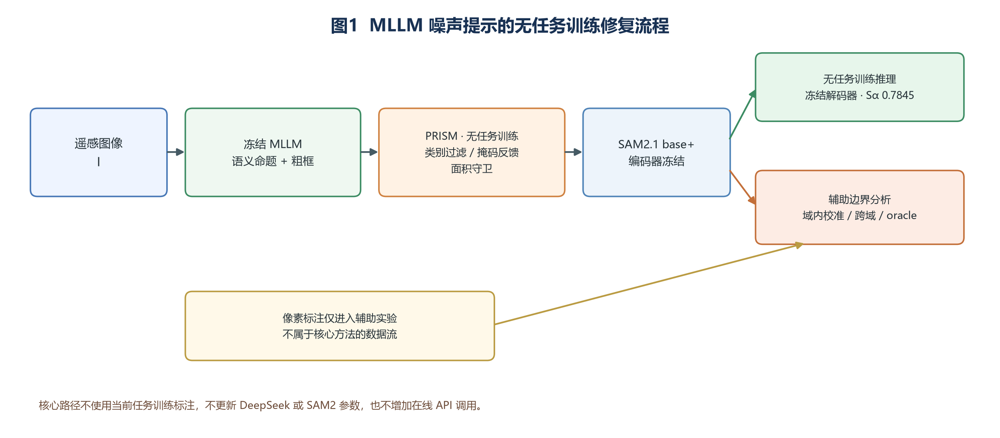
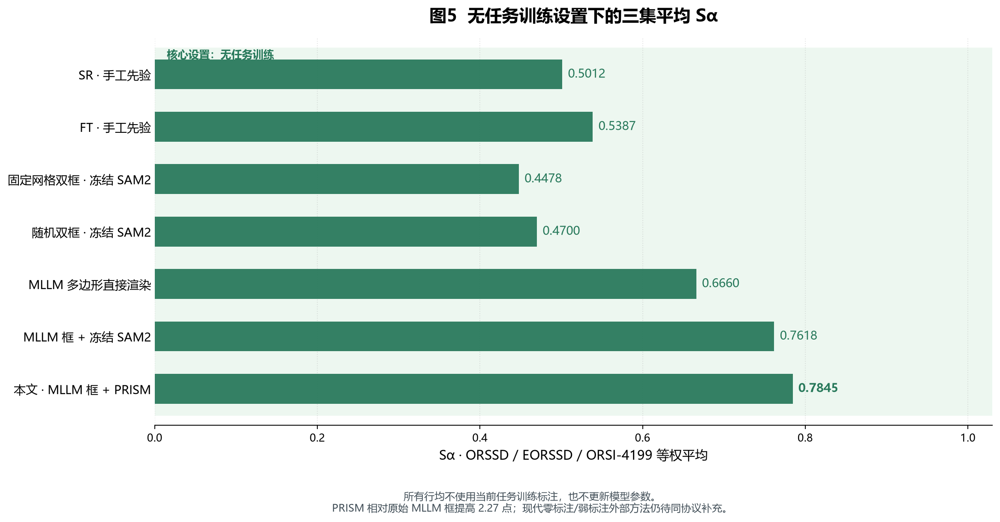

# 面向光学遥感显著性检测的噪声语义提示无任务训练修复

### Training-Free Repair of Noisy Semantic Prompts for Salient Object Detection in Optical Remote Sensing Images

> **v0.9 无任务训练主线稿，2026-10-10。** 核心方法仅指冻结DeepSeek提示、PRISM修复与冻结SAM2分割；域内监督校准、跨域训练和GT oracle均降为辅助边界分析，不计入核心方法结果。

---

## 摘要

**【目的】** 多模态大语言模型（MLLM）能够为光学遥感图像显著性目标检测提供“什么显著”和“大致在哪里”的语义提示，但粗框可能选中非显著区域、偏离目标或包含多余实例。本文研究在不使用当前任务训练标注、不更新MLLM与分割模型参数的条件下，如何提高噪声提示驱动分割的可靠性。

**【方法】** 冻结的DeepSeek视觉模型离线生成显著性命题、类别与候选框。PRISM不读取GT、不更新参数，先按图内类别一致性过滤多余候选，再利用冻结SAM2的掩码反馈调整框范围，并以面积守卫抑制大框反馈失控；冻结SAM2负责输出像素级显著图。所有核心结果均读取固定提示库复算，不在推理时访问MLLM API。

**【结果】** 在ORSSD、EORSSD、ORSI-4199上，冻结SAM2直接使用MLLM框的Sα为0.7805、0.7699、0.7351；加入PRISM后提高到 **0.7964、0.7949、0.7623**，三集等权平均由 **0.7618提升至0.7845**（+2.27点），且三集MAE均下降。真正不读取MLLM内容的固定网格双框和随机双框仅为0.4478和0.4700，表明图像相关的目标选择与定位信息不可由固定几何提示替代。对2,999张图的6,266个MLLM框进行事后几何匹配，47.2%与某个GT连通域外接框IoU达到0.5，32.1%的最大IoU低于0.1。

**【结论】** 冻结MLLM能够为遥感显著性检测提供有效的目标选择与粗定位，但其提示具有可测量的几何和候选噪声。PRISM在不引入任务训练、人工提示或额外API调用的条件下稳定改善冻结SAM2。本文贡献集中在MLLM提示可靠性的测量、修复及适用边界，而不把域内像素监督结果表述为零标注性能。

**关键词**：光学遥感；显著性目标检测；多模态大语言模型；提示修复；SAM2；无任务训练

---

## Abstract

**Objective.** Multimodal large language models (MLLMs) can identify salient entities and provide coarse boxes in optical remote sensing images, but the boxes may select irrelevant regions, have inaccurate extents, or contain extra instances. We study how to improve prompt-driven segmentation without task-specific annotations or parameter updates.

**Methods.** A frozen DeepSeek vision model generates semantic propositions, categories, and candidate boxes offline. PRISM filters candidates using within-image category consistency, adjusts box extents using frozen SAM2 mask feedback, and prevents unstable expansion with an area guard. Frozen SAM2 then produces the pixel-level saliency map. The core pipeline uses a fixed prompt bank and performs no task-specific training.

**Results.** Across ORSSD, EORSSD, and ORSI-4199, PRISM improves frozen-SAM2 S-measures from 0.7805, 0.7699, and 0.7351 to 0.7964, 0.7949, and 0.7623, respectively. The equal-dataset mean increases from 0.7618 to 0.7845 (+2.27 points), with lower MAE on all three datasets. MLLM-independent fixed-grid and random two-box controls obtain only 0.4478 and 0.4700. Of 6,266 MLLM boxes, 47.2% reach bounding-box IoU of at least 0.5 with a ground-truth component, while 32.1% have best IoU below 0.1.

**Conclusion.** Frozen MLLM prompts provide useful target selection and localization but contain measurable noise. PRISM improves frozen SAM2 without task-specific training, manual prompts, or additional MLLM calls. The contribution is the measurement and training-free repair of noisy semantic prompts rather than supervised decoder performance.

**Keywords**: optical remote sensing; salient object detection; multimodal large language model; prompt repair; SAM2; training-free inference

---

## 1 引言

### 1.1 研究问题

遥感显著性检测要求模型判断图像中哪些地物应成为前景，并给出像素级掩码。传统方法多用像素标注训练专门网络；分割基础模型能够执行提示分割，却不能自行确定显著目标。冻结 MLLM 可以根据场景生成语义命题和粗框，但这些框含有较明显的定位噪声。本文关心的具体环节是：**当语义提示存在多余候选、偏移和范围错误时，怎样在不训练提示模型的前提下修复输入，使分割器输出更符合遥感显著性标注？**

已有SaliLLM/FOCUS工作将显著性判断和提示分割分解，并讨论前景数量、范围和观察协议差异[5]。本文不把“MLLM提示+基础模型分割”的组合本身作为创新，而是聚焦一个具体问题：固定MLLM在光学遥感图像中生成的语义框是否可靠，以及在不训练任何任务模型时能否利用提示内部一致性和分割反馈降低这种噪声。

### 1.2 三项围绕提示可靠性的贡献

1. **提示误差诊断**：在固定 MLLM、三个公开遥感测试集上测量提示框与 GT 连通域外接框的匹配情况，并分析多余候选、范围偏差与类别关系。47.2% 和 32.1% 均为框 IoU 代理统计；基于文件名的类别正确率只用于可解析的 ORSI-4199 子集。
2. **零训练提示修复**：PRISM 通过类别一致性过滤、掩码反馈调整与超大框守卫处理候选框；在冻结 SAM2 的匹配对照下，三集 Sα 分别提升 1.59、2.51、2.72 点，宏平均提升 2.27 点。
3. **修复边界与失败条件**：用真正不读取MLLM内容的固定网格/随机框检验目标选择价值，并通过类别过滤误删审计和匹配组件消融说明PRISM何时有效、何时失效。域内监督校准与跨域训练只作为辅助边界，不构成核心方法贡献。

### 1.3 监督条件与研究范围

“提示模型零训练”“当前任务无参数训练”“目标域零标注”和“域内像素监督”是不同条件。本文以第一行的无任务训练推理为核心设置，其余三行仅用于解释泛化范围和性能边界：

| 设置 | 当前任务中使用的标注 | 被评测数据集训练划分的像素掩码 | 现有变体 | 在本文中的作用 |
|---|---|---|---|---|
| **核心T0：无任务训练推理** | 不用于训练或推理；GT只用于离线评测与事后诊断 | 否 | 冻结SAM2、冻结SAM2+PRISM | 验证提示修复的独立效果 |
| 辅助T2：源域像素监督、目标域零标注迁移 | 只允许源域训练标注，目标域GT只用于最终评测 | 否 | 三折干净留一实验 | 检查迁移边界 |
| 辅助T4：域内像素监督校准 | 使用被评测数据集训练划分的像素掩码 | 是 | 最终解码器 | 提供有监督精度参照 |
| 诊断项：GT提示oracle | 推理时使用被评测测试图的GT框 | 是 | `v09-gtbox-raw-s42/s43` | 诊断提示侧剩余空间，不属于可部署监督组 |

无任务训练指本文当前显著性任务不更新模型权重；SAM2和MLLM的基础预训练不在这一称谓内。实验开发过程曾根据带标注数据与多次测试结果选择方法，故此称谓也不意味着研究过程中从未查看标签。干净跨域三折为每个留出域单独从另外两个源域的训练划分提取统计并训练，目标域训练图像、训练掩码和测试掩码均不参与该折训练；但方法与超参数开发阶段看过公开测试结果，因此这里只称为协议内目标域零标注迁移，不声称完整研究过程从未接触目标域标签。

弱监督方法只作C级文献位置参照；本稿不对其性能作统一协议下的优劣结论。与全监督方法比较用于报告精度差距，不作为同一监督条件下的优越性证明。

## 2 相关工作

### 2.1 光学遥感显著性检测

MCCNet[1]、GeleNet[2] 等方法在像素监督下学习遥感显著性；SAM2-RS[3]通过训练适配模块把通用基础模型用于该任务。IPDiff[4]以扩散方式迭代细化预测。这些方法说明监督训练的精度标尺，也表明基础模型在遥感显著性中的应用已有先例。

### 2.2 MLLM 语义提示与前景组织

SaliLLM/FOCUS[5]将显著实体定位与像素分割分开研究，并通过观察协议和视觉证据组织前景；Saliency-R1[6]则训练 MLLM 执行显著性推理。本文使用冻结 MLLM，在遥感基准中量化其粗框错误，研究不训练任何任务模型的规则修复；有监督解码校准仅作为辅助边界分析。相关工作之间的数据、模型和评测指标不同；不能用自然图像上的框 IoU 与本文“严格匹配率”直接作高低判断，也不能把目前内部基线结果写成超越所有零训练方法。

与 FOCUS[5] 的可比性需进一步说明。两者均将 MLLM 定位证据交给通用分割器，并在推理时处理提示与显著性标注之间的差异；FOCUS 强调观察协议下的前景数量校准与自监督视觉特征构成的感知流形，本文的 PRISM 则在**光学遥感**图像中采用候选类别一致性和分割掩码反馈调整粗框。FOCUS 报告的 13 个基准属于 RGB、RGB-D、RGB-T 显著性检测，本文尚未在相同的 ORSSD、EORSSD、ORSI-4199 划分上复评其实现，因此这里只比较问题设置与机制，不给出数值优劣结论。本文的监督校准分支另使用三个被评测数据集训练划分的像素掩码，与 FOCUS 的无任务训练结果不能直接混排。

### 2.3 研究范围

SR、FT[8-9]是无任务训练的经典显著性先验，本文复现它们用作低复杂度参考。随机框与图像中心框是人工构造的位置对照；“MLLM 中心 + 固定尺寸框”保留了 MLLM 提供的中心和候选数，只用于分离框尺寸信息，不能作为无语义上界。本文已补充与 MLLM 无关且提示预算匹配的固定网格双框和随机双框对照，用于检验性能是否只是来自通用分割器及提示数量。

现代无人工标注训练方法与本文的T0设置也不相同。A2S-v3[12]先在自然图像SOD上进行无标签任务训练，再以零样本迁移或目标任务无标签微调处理遥感图像；3SD[13]利用自然图像上的自监督分类、CAM与边缘生成伪标签并训练SOD网络，二者在本文中分别归入T2-U或T1，而不是T0。LightEMNet[14]与SBA-Net[15]使用S-EOR涂鸦监督，归入T3。实验部分按监督组引用其原论文结果，只用于说明不同监督成本下的大致位置。

## 3 方法

### 3.1 总体流程

如图1，冻结 MLLM 先输出显著性语义命题和候选框；SAM2提供像素级执行。无任务训练分支使用完整PRISM后交给冻结SAM2；辅助监督校准分支加载在像素掩码上训练过的SAM2掩码解码器，其参照结果直接使用原始MLLM框。两分支共享同一离线提示库，但根据匹配消融采用不同的提示处理配置。

### 3.2 冻结 MLLM 提示生成

Pass1 给出显著性命题与类别，Pass2 根据命题给出归一化粗框。提示通过DeepSeek兼容API离线生成，保存记录中的模型标识为`deepseek-v4-flash-vision-exp`，温度为0；当前实现使用15词类别表、最多5个实例。测试集提示库包含2,999张图，训练集提示库包含4,000张图；下游实验均读取冻结提示库，不重新调用API。温度0与可解析输出支持程序运行一致性，但不保证云端模型版本变化后的逐次字节级重复；复现材料应同时发布模型标识、模板、调用时间和原始响应。

### 3.3 PRISM 提示修复

候选框被视为噪声集合。类别一致性过滤保留与图内最高置信框类别相同的框；掩码自收紧从初次解码掩码求外接框，按 α=0.05 外扩后再解码，最多迭代2轮；初始框面积超过图像面积25%时跳过收紧，以降低大框反馈的失控风险。三个规则在推理时不更新权重，也不读取该图 GT。

类别过滤可能误删不同类别的真实显著目标，掩码反馈也可能扩大错误区域。因此评价既报告Sα/MAE，也报告负面案例。最终权重分项结果显示类别过滤为正、掩码反馈为负；测试GT事后审计用于量化误删风险，但不进入推理流程。

### 3.4 核心冻结分割与辅助监督校准

核心执行层采用完全冻结的SAM2.1 base+，不加载适配权重。辅助校准分支冻结图像编码器和提示编码器，只训练`sam_mask_decoder`（4.22M参数），并使用公开数据集训练划分的像素掩码。该分支用于回答性能边界与组件交互，不属于本文无任务训练方法，也不参与核心方法的数值主张。

训练配方有先后版本，本文最终结果使用以下可追溯配置：三个数据集共4,000张训练原图，3个epoch；从这三集**训练划分**的MLLM框与GT匹配中形成 `prompt_stats_train.json`；按经验分布采样每图1个命中型提示和2个偏移型提示（`--prompt_src real --n_pos 1 --n_neg 2`）；用 SAM2 自报质量分选择掩码候选（`--cand_rule score`）；种子42、43分别训练。推理阶段分别评测原始框、PRISM分项和完整组合；辅助监督参照采用两种子原始MLLM框结果，因为匹配消融显示完整PRISM与该解码器存在负交互。real提示模式将多个候选的预测并集与整幅训练GT计算损失，不能把每个偏移框都描述成“独立以全空掩码监督”。

旧版本从GT连通域框抖动生成提示，并另采负样本框；其结果进入消融/历史对照。旧校准器中的训练候选选择与最终配方不同。单独的抖动、负样本、经验分布及候选选择贡献需要同一基线上控制变量，当前不按跨阶段差值强行归因。

## 4 实验

### 4.1 数据集、指标与评测口径

ORSSD、EORSSD、ORSI-4199测试图像分别为200、600、2,199张。报告 Sα、MAE；完整指标还包括 Fβmax 与 Eξmax。三集平均定义为三个数据集指标的**等权算术平均**，不是按2,999张图加权。GeleNet 使用官方保存的显著图，在本仓库相同测试划分和指标实现上重新评测。

### 4.2 无任务训练主结果

下表只放入不使用当前任务训练标注、不更新模型参数的方法与位置对照。GT仅用于统一离线评测，不进入提示生成或推理。域内监督校准和GT oracle移至辅助分析，避免与本表混排。

| 方法与提示来源 | 任务训练标注 | ORSSD Sα / MAE | EORSSD Sα / MAE | ORSI-4199 Sα / MAE | 三集平均Sα |
|---|---|---:|---:|---:|---:|
| SR手工先验[8] | 无 | 0.5153 / 0.1137 | 0.5422 / 0.0763 | 0.4461 / 0.1759 | 0.5012 |
| FT手工先验[9] | 无 | 0.5623 / 0.1985 | 0.5479 / 0.1694 | 0.5058 / 0.2592 | 0.5387 |
| 固定网格双框 + 冻结SAM2（MLLM无关） | 无 | 0.4584 / 0.2270 | 0.4454 / 0.2299 | 0.4396 / 0.2576 | 0.4478 |
| 随机双框 + 冻结SAM2（MLLM无关） | 无 | 0.4804 / 0.2127 | 0.4660 / 0.2058 | 0.4637 / 0.2344 | 0.4700 |
| MLLM多边形直接渲染 | 无 | 0.6788 / 0.0818 | 0.6700 / 0.0474 | 0.6492 / 0.1087 | 0.6660 |
| 冻结SAM2 + 原始MLLM框 | 无 | 0.7805 / 0.0752 | 0.7699 / 0.0462 | 0.7351 / 0.1053 | 0.7618 |
| **冻结SAM2 + MLLM框 + PRISM（本文）** | **无** | **0.7964 / 0.0686** | **0.7949 / 0.0398** | **0.7623 / 0.0906** | **0.7845** |

PRISM相对原始MLLM框在三集分别提高1.59、2.51和2.72点，宏平均提高2.27点，且MAE均下降。固定网格与随机双框不读取MLLM内容，结果显著低于图像相关MLLM框，说明冻结MLLM提供的目标选择与粗定位是这条无任务训练管线的必要信息来源。现代零标注或弱标注方法采用原论文数值作C级文献参照，见§4.2.1；这些数值不参与统一协议排名。

#### 4.2.1 外部零标注与弱标注文献参照

本节用于回答“本文处于零标注或弱标注方法中的什么位置”，不构成统一复评。带†的数值直接引自原论文；各论文的代码版本、测试实现和指标口径未经本项目统一，因此证据等级为C。缺失数据集记为“—”，不据此计算三集宏平均或宣称严格排名。

| 方法 | 分组 | 任务训练或人工监督 | ORSSD | EORSSD | ORSI-4199 | 处理 |
|---|---|---|---|---|---|---|
| FOCUS[5] | T0 无任务训练 | 冻结MLLM、视觉编码器与通用分割器 | — | — | — | 原文未报告本文三集，只作机制对照 |
| A2S-v3 `Ours`[12] | T2-U 外部无标签训练 | 自然图像无标注SOD训练后零样本迁移 | 有† | 有† | — | 数值见表A，指标不含Sα |
| A2S-v3 `Ours_f`[12] | T1 目标域无标签适配 | 在目标任务无标注图像上微调 | 有† | 有† | — | 与T0分组，不作为同级基线 |
| 3SD[13] | T2-U 外部无标签训练 | 自然图像自监督SOD训练 | — | — | — | 原文无遥感三集结果，只作方法背景 |
| LightEMNet[14] | T3 涂鸦弱监督 | S-EOR涂鸦监督训练 | — | — | — | 保留背景引用，避免转引未核原表数字 |
| SBA-Net[15] | T3 涂鸦弱监督 | S-EOR涂鸦及图像级类别信息 | 有† | 有† | — | 数值见表B，只作弱监督参考 |

**表A：A2S-v3原论文Table 5文献值†。** 该论文报告的是MAE、平均F-measure和平均E-measure，不是本文主表的Sα、Fβmax或Eξmax。

| 设置 | ORSSD MAE↓ / Fβavg↑ / Eξavg↑ | EORSSD MAE↓ / Fβavg↑ / Eξavg↑ |
|---|---:|---:|
| A2S-v3 `Ours`：零样本迁移 | 0.057 / 0.669 / 0.830 | 0.053 / 0.545 / 0.755 |
| A2S-v3 `Ours_f`：目标任务无标签微调 | 0.053 / 0.726 / 0.874 | 0.064 / 0.625 / 0.808 |

**表B：SBA-Net原论文Table 1文献值†。** 这里只摘录与本文主表同名的Sα和MAE；原论文还报告Eavg、Emax、Favg与Fmax。

| 设置 | ORSSD Sα↑ / MAE↓ | EORSSD Sα↑ / MAE↓ |
|---|---:|---:|
| SBA-Net：S-EOR涂鸦弱监督 | 0.862 / 0.026 | 0.861 / 0.014 |

A2S-v3说明无人工像素标签的任务训练与迁移能够形成可用的遥感显著性结果；SBA-Net说明少量涂鸦监督可进一步提高结构定位。二者使用的监督和指标不同，不能据表中数字推导本文优于或落后于哪一类方法。本文核心主张仍限定为：在冻结MLLM和冻结SAM2的无任务训练管线内，PRISM相对同一管线的原始提示稳定改善结果。

### 4.3 提示错误诊断及PRISM的匹配比较

2,999张图共生成6,266个框。与GT连通域的**外接矩形**按框IoU比较，2,958个框达到0.5（47.2%），2,013个框低于0.1（32.1%），其余1,295个为中等匹配（20.7%）。提示框并集覆盖的GT前景像素比例平均为82.0%，框并集中的GT前景像素比例平均为38.4%。这些数字说明框在几何上宽松和不稳，但不足以逐框判定“MLLM语义幻觉”。

在ORSI-4199中，只有文件名类别可解析的子集可用于类别正确率。最高置信框类别与文件名映射类别一致的比例为1516/1660（91.3%）；相关框中，类别一致与不一致两组的严格匹配率分别为67.7%和9.4%。这为类别过滤提供动机，不能外推为全部三集或其他MLLM的普遍规律。类别过滤也可能误删多类别显著目标，相关风险在失败案例中报告。

| 核心无任务训练比较 | ORSSD Sα变化 | EORSSD Sα变化 | ORSI-4199 Sα变化 | 三集平均变化 |
|---|---:|---:|---:|---:|
| 冻结SAM2：A2 → A2+P | 0.7805 → 0.7964 | 0.7699 → 0.7949 | 0.7351 → 0.7623 | **+2.27点** |

核心结果只说明完整PRISM对冻结SAM2有效，不把监督训练产生的提升并入方法增益。规则与训练后解码器的交互另列为辅助边界分析。

类别过滤共删除1,570个候选。按测试GT事后审计，其中44个达到与任一GT连通域框IoU≥0.5，21/2,999张图失去全部此类框。辅助匹配解码器上的逐图分析显示，这21张图平均Sα下降11.91点；该事后结果用于揭示多类别场景风险，不参与推理决策。

为避免旧`pointfixed`保留MLLM中心造成混淆，另构造每图两个固定网格框和按文件名哈希确定的随机框，两者均不读取MLLM内容或GT。在冻结SAM2上，两者宏平均仅0.4478和0.4700，原始MLLM框为0.7618。这说明图像相关的目标选择和粗定位不可由固定几何提示替代；但双框仅在全局平均上匹配MLLM框数，框尺度也不同，因此该差值不能全部命名为纯语义贡献。

### 4.4 辅助分析：监督校准与组件交互

本节所有结果均使用训练划分像素掩码，不属于无任务训练主方法。保留这些实验是为了检验PRISM是否能与学习型解码器直接叠加，并界定规则的适用范围。

| 辅助匹配比较 | ORSSD Sα变化 | EORSSD Sα变化 | ORSI-4199 Sα变化 | 三集平均变化 |
|---|---:|---:|---:|---:|
| 改进校准器：无PRISM → 加PRISM | 0.9008 → 0.9120 | 0.8805 → 0.8899 | 0.8346 → 0.8415 | +0.92点 |
| 最终seed42：原始框 → 仅类别过滤 | 0.9181 → 0.9286 | 0.8998 → 0.9096 | 0.8590 → 0.8642 | +0.85点 |
| 最终seed42：原始框 → 仅掩码反馈 | 0.9181 → 0.9165 | 0.8998 → 0.8914 | 0.8590 → 0.8557 | −0.45点 |
| 最终两种子：原始框 → 完整PRISM | 0.9216 → 0.9177 | 0.9031 → 0.9000 | 0.8596 → 0.8566 | −0.33点 |

最终权重分项表明，类别过滤在三个数据集均提高Sα，宏平均增益的逐图分层bootstrap 95% CI为+0.58至+1.12点；掩码反馈调整在三个数据集均降低Sα，面积守卫的宏平均影响不足0.06点。完整PRISM在两种子平均上比原始框低0.33点。这一负交互支持将完整PRISM限定为冻结SAM2主线，而不是把所有模块串成一个“多面能手”。

最初校准器由GT连通域框加10%抖动构造训练提示；改进版本使用更大抖动与额外负样本。三集测试宏平均在**无PRISM**条件下从0.8389到0.8719，增加3.30点；再加PRISM到0.8811，增加0.92点。后者是PRISM的边际效果，不能记作“负样本独立贡献”。单独扩大抖动的dev结果在《实验_T1_训练分布修正》中，不能与三测试集总增益直接拆分相加。

进一步的最终配方从训练划分的MLLM提示估计经验形态分布，按该分布合成训练提示，训练时用SAM2自报分选候选。两份权重在原始MLLM框上的宏平均分别为0.8923和0.8972，均值0.8948；加入完整PRISM后分别为0.8920和0.8909，均值0.8914。相对旧改进校准器+PRISM的0.8811，最终权重和完整流程提高约1.03点，但多个训练因素同时改变，只可称配方级观察；辅助监督参照采用匹配消融中更高且两种子齐全的原始框配置。

使用测试集真值计算的提示统计曾在完整PRISM配置下得到两种子均值0.8961。该结果为提示统计来源敏感性的诊断，**不进入最终方法主表**，也不能称为方法在干净评测下的上界；它比训练集统计的同类完整PRISM结果0.8914高约0.46点。原始框主结果0.8948属于不同推理配置，不能与该差值混算。

### 4.5 辅助分析：干净的留一数据集迁移

每折只用另外两个源域的训练图像、训练掩码和训练集MLLM提示提取统计并训练seed42解码器；留出域只用于最终推理和评测。三折与域内P1-c使用相同的类别过滤、2轮反馈调整和面积守卫。

| 留出测试集 | 源域训练集 | Sα | MAE | 相对同种子域内Sα |
|---|---|---:|---:|---:|
| ORSSD | EORSSD + ORSI-4199 | 0.9016 | 0.0230 | −1.88点 |
| EORSSD | ORSSD + ORSI-4199 | 0.8799 | 0.0148 | −1.77点 |
| ORSI-4199 | ORSSD + EORSSD | 0.8317 | 0.0478 | −2.64点 |
| 三集等权平均 | — | **0.8711** | 0.0286 | **−2.10点** |

与域内两种子完整流程0.8914比较，干净迁移下降2.04点，4,000次分层bootstrap的95% CI为−2.49至−1.61点；相对冻结零训练管线0.7845提高8.65点，95% CI为+7.56至+9.77点。结果说明源域像素监督可迁移，但目标域训练仍提供稳定优势。由于方法和超参数开发阶段曾查看公开测试结果，该实验只证明按最终训练数据流没有使用留出域标注，不等同于完整研究开发过程的盲测。

### 4.6 辅助分析：提示oracle、主干与负结果

在统一关闭PRISM、固定最终解码器的条件下，seed42原始框宏平均为0.8923，GT连通域框为0.9158（+2.35点），删除错框为0.8950（+0.27点），补漏框为0.8972（+0.49点），校正命中框范围为0.8967（+0.43点）。删除错框在EORSSD下降0.27点，说明oracle定义及干预之间存在交叉，不能把三项增益相加。

seed43原始框和GT框分别为0.8972和0.9144。两种子平均后，原始框为0.8948，GT框为0.9151，提示侧剩余空间为2.03点；逐集差值为ORSSD +1.87点、EORSSD +2.43点、ORSI-4199 +1.80点。GT框使用测试真值，只是反事实诊断。GT框结果仍低于GeleNet同协议复评0.9235约0.84点，表明剩余误差不能只归因于MLLM提示。

冻结、无校准条件下把SAM2.1 base+换成large，三集平均Sα从0.7618到0.7636，增益约0.18点。这个结果仅约束**本次未适配配置**；large校准器训练尚无结果，故不排除训练后模型容量的作用。

网格点候选补漏在dev 50上测试的配置没有达到预设改进阈值，可报告为所试配置的负结果。此前“几何可达率0/486”的实现把8倍尺寸处IoU不足阈值误判为所有尺度无解，不能用来证明所有网格框或类无关提示几何上不可达。修复判定算法并重算前，本文不将该证据用于瓶颈结论。

## 5 讨论

**方法作用。** 核心证据是完整PRISM在冻结SAM2和三个数据集上均提高Sα，同时降低MAE。它处理的是固定MLLM提示的候选和范围噪声，不训练新的显著性模型。辅助监督实验显示规则修复与学习型校准不能假定直接叠加，这一结果用于限定方法边界，不改变无任务训练主线。

**误差解释。** MLLM提示的框IoU较低，可能来自选错对象、外接框范围与目标形状差异、同一图像多实例或标签约定差异。MLLM无关的双框对照验证了图像相关目标选择的价值，但因提示预算和尺度只做近似匹配，不能把全部差值解释成纯语义贡献。类别过滤在21张图上失去全部严格匹配框，混合类别场景是明确失败模式。

**评测边界。** §4.2.1已经补入现代无标签训练与弱标注方法的文献结果，能够说明不同监督条件下的大致性能位置，但这些C级证据不支持“统一协议下优于现代零标注或弱标注方法”的结论。当前稿件不再把外部方法复评设为必做项；若审稿人明确要求严格排名，再升级为同划分、同代码的A/B级复评。测试集在开发过程中评测过多种配置，不能视作完全独立的盲测。公开基准图像也可能出现在基础模型预训练语料中，目前无法完全排除这一因素。

## 6 结论

本文聚焦光学遥感显著性检测中的一个具体问题：冻结MLLM能够指出显著目标，但其候选框存在多余实例、偏移和范围误差。PRISM利用提示内部类别一致性和冻结SAM2反馈进行无任务训练修复，在ORSSD、EORSSD和ORSI-4199上分别将Sα提高1.59、2.51和2.72点，宏平均从0.7618提高到0.7845，且三集MAE均下降。

本文不把DeepSeek与SAM2的组合本身作为创新，也不把域内像素监督结果包装成零标注性能。贡献在于量化遥感MLLM提示的不可靠性，给出无需训练和额外API调用的修复方法，并通过无MLLM位置对照、误删审计和辅助监督实验说明其作用与失效边界。现代无标签训练和弱标注方法已作为文献参照补入；其数值不承担统一协议排名证据。

## 参考文献

[1] LI G, LIU Z, LIN W, et al. Multi-content complementation network for salient object detection in optical remote sensing images[J]. IEEE Transactions on Geoscience and Remote Sensing, 2022, 60: 5614513. DOI: 10.1109/TGRS.2021.3131221.

[2] LI G, BAI Z, LIU Z, et al. Salient object detection in optical remote sensing images driven by transformer[J]. IEEE Transactions on Image Processing, 2023, 32: 5257-5269. DOI: 10.1109/TIP.2023.3314285.

[3] SUN J, LIANG S, ZHAO Y. Unleashing the potential of segment anything model 2 for efficient salient object detection in optical remote sensing images[J]. IEEE Transactions on Geoscience and Remote Sensing, 2026, 64: 5620513. DOI: 10.1109/TGRS.2026.3689569.

[4] LI G, BAI Z, CONG R, et al. IPDiff: diffusion-driven ORSI salient object detection with information reconstruction and multi-prior guidance[J/OL]. arXiv:2607.03696, 2026.

[5] ZHAO W, LI X, MAO Z, et al. Is it time for the renaissance of salient object detection in the era of MLLMs?[J/OL]. arXiv:2607.29222, 2026. （SaliLLM与FOCUS出自同一论文，合并v0.8中的重复条目。）

[6] LI L, JI S, LUO Z, et al. Saliency-R1: incentivizing unified saliency reasoning capability in MLLM with confidence-guided reinforcement learning[J/OL]. arXiv:2511.00396, 2025.

[7] RAVI N, GABEUR V, HU Y T, et al. SAM 2: segment anything in images and videos[J/OL]. arXiv:2408.00714, 2024.

[8] HOU X, ZHANG L. Saliency detection: a spectral residual approach[C]//CVPR. 2007: 1-8. DOI: 10.1109/CVPR.2007.383267.

[9] ACHANTA R, HEMAMI S, ESTRADA F, et al. Frequency-tuned salient region detection[C]//CVPR. 2009: 1597-1604. DOI: 10.1109/CVPR.2009.5206596.

[10] FAN D P, CHENG M M, LIU Y, et al. Structure-measure: a new way to evaluate foreground maps[C]//ICCV. 2017: 4548-4557. DOI: 10.1109/ICCV.2017.487.

[11] FAN D P, GONG C, CAO Y, et al. Enhanced-alignment measure for binary foreground map evaluation[C]//IJCAI. 2018: 698-704. DOI: 10.24963/ijcai.2018/97.

[12] YUAN Y, LIU W, GAO P, et al. Unified unsupervised salient object detection via knowledge transfer[C]//IJCAI. 2024: 1616-1624. DOI: 10.24963/ijcai.2024/179.

[13] YASARLA R, WENG R, CHOI W, et al. 3SD: self-supervised saliency detection with no labels[C]//WACV. 2024: 313-322. DOI: 10.1109/WACV57701.2024.00038.

[14] XING G, WANG M, WANG F, et al. Lightweight edge-aware Mamba-fusion network for weakly supervised salient object detection in optical remote sensing images[J]. IEEE Transactions on Geoscience and Remote Sensing, 2025, 63: 1-13. DOI: 10.1109/TGRS.2025.3587287.

[15] HUANG Z, XIANG T Z, CHEN H X, et al. Scribble-based boundary-aware network for weakly supervised salient object detection in remote sensing images[J]. ISPRS Journal of Photogrammetry and Remote Sensing, 2022, 191: 290-301.
