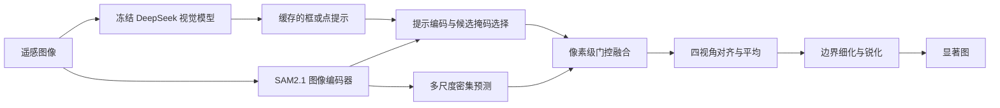

# 面向光学遥感显著目标检测的多模态语义提示生成与实际框适配

**Multimodal Semantic Prompt Generation and Adaptation to Model-Generated Boxes for Salient Object Detection in Optical Remote Sensing Images**

## 摘要

多模态大语言模型（MLLM）可为遥感显著目标提供位置线索，但直接生成的提示框存在错选、漏选和范围偏差。本文提出 DS-SOD，具体研究两处 MLLM 用法。推理侧，冻结的 DeepSeek 视觉模型先用类别、显著理由和自然语言方位描述至多五个候选实例，再接收原图与实例记录，将其转换为 SAM2 可用的粗框或点。训练侧，从训练图的 MLLM 框中采集偏移和尺度误差，并在后续微调时以同一图像的实际框组替换部分或全部可替换的模拟框组。固定测试提示、初始化和推理配置，ORSI-4199 上优先使用实际框较 50% 混合方案提高 Sα 0.00026，逐图配对 95% 置信区间为 [0.00014, 0.00038]。在三套官方测试集上，DS-SOD 共用流程的平均 Sα 为 0.92398，分集最高实测值的平均为 0.92623。以上结果分别反映实际提示参与训练的局部收益与完整系统的分数，双轮提示生成的独立收益仍待同预算对照确认。

**关键词**　光学遥感；显著目标检测；多模态大语言模型；SAM2；域适配；提示噪声

## Abstract

Multimodal large language models (MLLMs) can provide location cues for salient objects in optical remote sensing images, yet their prompts may select incorrect targets, miss instances, or misestimate object extent. DS-SOD studies two specific uses of MLLM prompts. At inference, a frozen DeepSeek vision model first describes up to five salient instances by category, saliency rationale, and verbal location. It then receives the image and the structured instance list to produce coarse boxes or points for SAM2. During training, we collect position and scale errors from MLLM boxes on the training split. Subsequent fine-tuning replaces some or all eligible simulated box groups with actual boxes generated for the same image. With fixed test prompts, initialization, and inference settings, prioritizing actual prompts improves S-measure on ORSI-4199 by 0.00026 over a 50% mixture, with a paired 95% confidence interval of [0.00014, 0.00038]. The common DS-SOD pipeline averages 0.92398 across three official test sets, while the post hoc mean of the dataset-specific observed maxima is 0.92623. The relative contribution of the two-call prompting protocol remains to be established under a matched call budget.

**Keywords**　optical remote sensing; salient object detection; multimodal language models; SAM2; domain adaptation; noisy prompts

## 1 引言

光学遥感显著目标检测旨在从俯视图像中识别并分割最值得关注的地物。与自然图像相比，遥感图像中的目标可以沿任意方向分布，面积从稀疏的小型实例到横跨整幅图像的设施不等。背景纹理、相邻地物和相似实例都会干扰目标选择。输出除了要定位显著目标，还要保留其轮廓、内部结构及多个实例之间的关系。

MCCNet 和 GeleNet 等像素监督方法通过上下文建模直接生成显著图 [1–2]。SAM2 可根据框或点提示生成高分辨率掩码 [3]，但提示式分割需要先决定分割对象。多模态视觉模型可以从整幅图像给出显著地物描述和空间提示，由此将目标选择与精细分割分开。问题在于，框可能遗漏小目标或指向错误地物，解码器还可能把框附近的背景误分成前景。仅靠扩大模型或在推理阶段反复修框，难以区分这些误差。

本文聚焦一个具体问题：**如何把 MLLM 对遥感图像的显著对象判断转成可训练、可复用的粗框提示，并让 SAM2 适应这些提示的实际误差？** MLLM 的用途贯穿提示生成和训练输入构造。本文的主要贡献如下。

1. **把对象选择与粗框定位拆为两次受约束的 MLLM 调用。** 第一轮从图像输出最多五个显著实例的类别、显著理由与自然语言方位，并用遥感场景中的前景和背景规则约束对象粒度。第二轮接收同一图像与第一轮的结构化记录，将对象清单转换成归一化几何提示。清洗后，多边形转成外接框，框和点交给 SAM2。该设计给出了从语义判断到可复用提示的具体接口，目前尚未用只调用一次的同预算对照量化拆分本身的收益。
2. **从 MLLM 原始框提取可重采样的误差，再将实际框引入监督微调。** 在训练划分内以真值连通域为参照，把框的中心偏移和宽高比例按命中与失配分组，供基础训练采样。后续微调直接读取同一训练图的实际框组，有可用框时可替换模拟框组。这样既覆盖经验几何误差，也让分割器接触同一图像上实际出现的候选组合。固定测试框、初始权重和推理配置后，ORSI-4199 官方对照中，提高实际框的使用比例使 Sα 从 0.890972 增至 0.891228。该结果支持提示来源的作用，适用范围限于该对照。

本文同时报告提示错误统计、历史真值框诊断和近期修框负结果，用以说明上述设计的适用边界。SAM2 主干微调、密集融合、四视角和切块作为支撑分割性能的实现与实验配置，分别报告其作用。

## 2 相关工作

### 2.1 光学遥感显著目标检测

传统监督方法通常从整图特征中学习目标与背景的关系。MCCNet 融合前景、背景、边缘与全局信息，GeleNet 则结合全局提取和局部探索 [1–2]。IPDiff 将显著图预测建模为条件扩散，并在多个去噪步骤中细化结构 [4]。这些方法提供了性能参照，也表明边界精度和结构一致性需要分别衡量。

### 2.2 分割基础模型与语义提示

SAM2 通过提示控制实例分割范围，并对候选掩码预测质量分数 [3]。SAM2-RS 将 SAM2 适配到遥感显著性检测，是与本研究直接相关的监督基线 [5]。DS-SOD 使用由冻结视觉模型从输入图像生成的显式粗框，再对 SAM2 的掩码预测进行域适配。由此可以在固定测试提示的情况下比较分割器，在固定分割器的情况下诊断提示质量。

### 2.3 提示来源与训练和推理的一致性

框提示包含对象选择与空间范围两种信息。由标注掩码生成的紧框提供了明确的对象与较准确的边界，适合检验提示式分割器对理想输入的响应。围绕真值框作均匀扰动可以模拟位置与尺度误差，但仍以标注对象为中心。一张图上由 MLLM 共同生成的候选集合还可能包含错类实例、背景区域或遗漏对象。即使模拟框与实际框在平均 IoU 上接近，其候选数量、相对位置与共现关系也可能不同。

本文据此区分三个层面：目标类别与自然语言方位约束粗定位；经验误差采样使基础分割器接触一组可控的几何偏差；实际框组参与后续微调，使模型观察同一图像中真实发生的提示组合。实验中固定测试提示库，通过只改变训练框来源来比较第三层。两轮提示相较直接定位的收益属于另一问题，不能从训练框来源对照中推出。

## 3 方法

### 3.1 整体流程

给定图像 $I$，冻结的 DeepSeek 视觉模型先生成潜在显著对象的描述，再输出候选框或点。提示数据保存为逐图记录，包括目标类别、置信度与归一化坐标。SAM2 图像编码器为视角变换后的图像提取特征，提示编码器对各提示编码，掩码解码器输出候选并根据自报质量分数选择掩码。多提示结果经像素级最大值组成提示显著图。并行的密集分支从多尺度特征预测整图显著性，通过门控逐像素融合两类输出。各视角结果逆变换到原坐标后取平均，并执行边界细化。图 1 给出这一流程。



*图 1　DS-SOD 的共用推理流程。分集配置可在四视角整图预测和边界细化之间引入切块修正。*

### 3.2 两阶段 MLLM 提示生成

**第一轮为语义筛选。** 对原图给出显著实例清单，每个实例包含预定义类别、显著理由与自然语言方位。提示词要求优先选独立、完整的地物，并限制在存在清晰前景时将大片承载区域视为背景。例如，在深色海面中出现多艘清晰船只时，输出可包含“船、与海面形成对比、画面中部偏左”。水域规则保留例外，连续水体本身是画面唯一主体时可以被选择。

**第二轮为几何定位。** 将完整的第一轮 JSON 回填到第二轮模板，并再次提供原图。第二轮为候选实例给出类别、置信度和多边形、框或点之一，坐标归一化到 $[0,1000]$。程序检查几何记录并保存清洗结果，多边形转换为最小轴对齐外接框，点提示用于极小目标。第一轮的理由和方位主要用于约束第二轮定位。SAM2 的直接输入是转换后的框与点；模型自报置信度也不等同于 SAM2 的掩码质量预测。

**输出约束与清洗。** 按显著程度保留至多五个候选。对框记录检查字段类型与宽高，裁剪超出图像的坐标；对多边形和点使用相应的合法性检查，丢弃无法解析的实例。多边形转框时，分别计算横纵坐标的极值。设顶点为 $(x_j,y_j)$，输出为

$$
b=(\min_j x_j,\ \min_j y_j,\ \max_j x_j-\min_j x_j,\ \max_j y_j-\min_j y_j). \tag{1}
$$

对于原图宽高 $W,H$，归一化框 $(x,y,w,h)$ 映射为像素坐标 $(Wx/1000, Hy/1000, W(x+w)/1000, H(y+h)/1000)$。保存原始几何记录、清洗结果与按图像索引的提示，便于区分模型生成错误与几何转换错误。若得到空提示，提示分支贡献零图，密集分支仍可从图像特征预测前景。调用失败与合法空输出在构建日志里有不同状态，应分别统计。

**接口示例。** 以“水面中部偏左的小船”为例，以下片段展示字段传递关系。坐标为说明性示意，不参与任何实验统计。

| 阶段 | 输入 | 主要输出 | 在后续流程中的用途 |
|---|---|---|---|
| 语义筛选 | 原图、类别表、场景约束 | 船、与水面形成对比、中部偏左 | 为粗定位指定候选及大致方位 |
| 几何定位 | 原图、第一轮结构化输出 | 船、归一化框 $[430,420,70,32]$ | 保留目标的粗位置与范围 |
| 转换与解码 | 合法几何提示、图像特征 | SAM2 候选掩码和掩码质量分数 | 选取掩码并融合为显著图 |

同一类别的多个实例可以分别生成提示；类别不是空间上的唯一标识。第二轮模板要求其输出与第一轮实例对应，但程序采用结构和几何校验，类别一致性是一项可统计的结果。它不保证选中的对象符合人工显著性标注。

### 3.3 实际提示与经验误差分布

设训练样本的真值显著图为 $Y$。对于训练集中每个 MLLM 框，选取 IoU 最大的真值连通域外接框作为参照。设参考框中心为 $(c_x,c_y)$，宽高为 $(w,h)$，MLLM 框对应量记为 $(\hat c_x,\hat c_y,\hat w,\hat h)$。记录归一化中心偏移 $((\hat c_x-c_x)/w,(\hat c_y-c_y)/h)$ 和尺寸比例 $(\hat w/w,\hat h/h)$。按最大 IoU 是否达到 0.5 划分两组，在基础训练中对训练图的参考连通域重采样。这一划分帮助构造训练输入，低 IoU 框可以覆盖部分真实目标。

在后续微调中，按训练图 ID 查询实际提示库。对已获得模拟框且满足替换条件的训练样本，以设定概率将模拟框组替换为该图的实际框组。替换前检查坐标有限性和几何有效性；实际框不可用时保留模拟框。框类别与置信度可留档用于分析，这项替换实验按几何框使用实际提示。官方评测在各组读取相同缓存提示，测试真值仅用于计算指标和事后诊断。

经验采样对于参考连通域 $C$，从对应经验组抽取 $(d_x,d_y,s_w,s_h)$，生成中心 $(c_x+d_xw,c_y+d_yh)$、尺寸 $(s_ww,s_hh)$ 的候选框。中心和尺寸变换后裁剪到原图。基础对照中每个样本尝试采样 1 个命中型、2 个失配型框，裁剪后无效的框会被过滤，因此实际数量可以小于 3。按冻结训练清单提取的统计库用于留出与正式续训对照，测试集提示统计只用于第 4.5 节诊断。

令 $B_i^{\mathrm{sim}}$ 和 $B_i^{\mathrm{act}}$ 分别为训练图 $i$ 的模拟框组与实际框组，$q$ 为替换概率。先构造合法模拟框组，再依据独立随机流抽取 $z_i\sim\mathrm{Bernoulli}(q)$。当 $z_i=1$ 且实际框组有效时取 $B_i=B_i^{\mathrm{act}}$，否则取 $B_i=B_i^{\mathrm{sim}}$。独立随机流避免仅因是否启用框组替换而改变模拟框采样和样本打乱顺序。该实现保留原训练的样本筛选：没有合法模拟框组的样本会跳过，$q=1$ 也不引入空提示训练。实际框由冻结模型生成，优化所需真值掩码来自训练划分。

每个提示产生候选掩码及质量预测。记 $P_j$ 为第 $j$ 个提示下质量评分最高的候选概率图，整图的提示预测为 $P=\max_jP_j$。SAM2 适配阶段使用二元交叉熵与软 IoU 损失监督 $P$。监督作用于多提示并集，因此无法直接获得每个错误提示对应的独立监督信号。该限制在误差分析中单独讨论。

记像素索引为 $u$，基本训练损失写为

$$
\mathcal{L}(P,Y)=\operatorname{BCE}(P,Y)+1-
\frac{\sum_u P_uY_u}{\max(\epsilon,\sum_u(P_u+Y_u-P_uY_u))}. \tag{2}
$$

质量分数来源于 SAM2 的候选掩码评分头，训练和推理在本项对照中采用同类选择规则。没有用真值 IoU 为每个提示挑选最优候选。同一像素处的最大值融合使目标可由任一提示覆盖，也使错误框造成的额外前景进入并集。实际框替换改变的正是这一监督条件下的候选输入。

近期末两阶段微调在同一初始权重上更新 Hiera 最后两个阶段、特征融合颈部和 SAM2 掩码解码器，提示编码器保持冻结。设初始参数为 $\theta_0$，微调得到的参数为 $\theta_1$，则推理使用 $\theta_0+\lambda(\theta_1-\theta_0)$，其中 $\lambda$ 表示应用的权重增量比例。未更新参数继承自对应初始权重。此处的末两阶段指后续微调范围。其初始权重来自既有的多阶段监督适配流程，早期流程包含更广的编码器更新和跨数据集训练。

### 3.4 密集融合与四视角推理

将 SAM2 多尺度特征经逐层投影、上采样和残差相加得到密集预测 $D$。门控网络读取特征、密集预测和提示概率图，产生逐像素权重 $g\in[0,1]$，融合为 $Q=(1-g)P+gD$。密集融合头训练时冻结 SAM2，损失为融合图的 BCE–IoU 与 0.5 倍密集预测 BCE–IoU 之和。推理分别处理原图、水平翻转、垂直翻转和双向翻转，坐标逆变换后对概率图取平均。

边界细化按邻域像素的空间距离和 RGB 差异加权平均，利用 $2p(1-p)$ 对不确定像素施加更大修正。随后对概率作对称幂变换 $p^\gamma/[p^\gamma+(1-p)^\gamma]$。共用流程采用 5×5 邻域与 $\gamma=1.25$。分集实验使用包含提示的重叠区域作局部推理。ORSSD 的切块用于补充近边缘前景；EORSSD 的切块用于抑制经局部预测确认的可疑背景，并使用 7×7 邻域及 $\gamma=1.40$。EORSSD 当前最高分配置仅让整图路径使用额外的主干微调权重，切块预测沿用原预测器及高分辨率融合头。

对中心像素 $u$ 和邻域像素 $v$，令 $w_{uv}=\exp[-\lVert u-v\rVert^2/(2\sigma_s^2)-\lVert I_u-I_v\rVert^2/(2\sigma_c^2)]$，细化将 $p_u$ 向归一化邻域平均值移动。EORSSD 分集配置取空间尺度 2.0、颜色尺度 25 和修正强度 1.5，切块混合的最大权重为 0.25。切块候选由已有图像与提示组成，与 MLLM 的两次调用无关。

### 3.5 训练与推理数据流

```text
提示构建
  对每张需要生成提示的图像执行语义筛选和几何定位。
  校验几何数据，并以数据集标识和文件名建立提示记录。
基础适配与实际框微调
  从冻结训练清单构造误差分布并采样模拟框组。
  按指定概率用同图实际框组替换有效模拟框组。
  以 SAM2 质量评分选掩码，用训练掩码监督并集。
评测
  读取固定测试记录，逐视角解码与密集融合。
  对齐四视角并取平均，按已登记配置细化显著图。
  用测试掩码计算指标，配对比较相同图像上的变化。
```

该流程允许独立替换提示缓存、训练权重或推理组件。表 4 的训练输入对照固定测试缓存与推理设置，表 3 的权重对照则固定提示来源和后处理配置。

## 4 实验

### 4.1 数据、协议与复现参数

ORSSD、EORSSD 和 ORSI-4199 分别含 600/200、1400/600 和 2000/2199 张官方训练/测试图 [6–8]。开发实验使用从官方训练图划出的固定留出集，三集分别包含 60、140 和 200 张图。EORSSD 与 ORSI-4199 的近期微调分别从固定划分的 980 和 1400 张训练图中采样。末两阶段对照使用 SAM2.1 Base+，600 次优化器更新，种子 42，掩码解码器学习率 $3\times10^{-5}$，编码器学习率 $3\times10^{-6}$。该阶段约有 71.21M 个可训练参数，另有独立训练的密集融合头。现有实验在 RTX 3090 上执行。测试提示库固定，训练清单中的官方测试记录由脚本检查排除。最终权重各祖先的跨数据集图像重复审计仍需补齐。开发期间曾多次使用官方测试集比较配置，因此最高实测汇总具有事后选择性质。

**划分与训练来源。** 官方训练集规模不等于近期微调可使用的样本数，近期微调使用冻结清单中的训练子集，且按 600 次优化器更新控制预算。官方流程中的基础权重还经过较广范围的监督适配与涉及多个数据集的续训。用于 ORSI-4199 的历史留一数据集结果与此主流程采用不同训练协议，本文未把历史迁移分数混入当前主表。EORSSD 是 ORSSD 的扩展数据集之一，两者名义上的训练和测试文件路径分开仍不足以排除跨数据集近重复。

| 数据集 | 官方训练图 | 官方测试图 | 冻结留出图 | 冻结训练子集图数 |
|---|---:|---:|---:|---:|
| ORSSD | 600 | 200 | 60 | 420 |
| EORSSD | 1400 | 600 | 140 | 980 |
| ORSI-4199 | 2000 | 2199 | 200 | 1400 |

*表 1　数据集与划分规模。冻结训练子集和留出集之和小于官方训练划分，外部结果未采用这一开发划分。*

主要指标为结构度量 Sα [9] 和平均绝对误差 MAE。三集平均等权，不按图像数汇总。受控比较对同一批图像的逐图 Sα 差值作 10000 次配对 bootstrap；区间跨零时，保留点估计但不据此声称稳定提升。新版主表报告已核实的 Sα 和 MAE。maxF、maxE 需在统一导出的显著图上复评。

**指标实现。** 将预测图对齐至标注分辨率，真值以灰度值大于 128 二值化。预测图从 8 位强度映射到 $[0,1]$，非恒定预测再作逐图最小–最大归一化。对同时含前景与背景的图像，Sα 取对象感知相似度与区域感知相似度的加权和，权重 $\alpha=0.5$。MAE 为归一化预测与二值真值的逐像素绝对差的平均。背景误检率用于诊断，按阈值 127 对保存的 8 位预测图二值化后，在真值背景像素上计算。按数据集对逐图指标求均值，再计算三集等权平均。

**配对区间。** 对同一测试集内每张图计算两组预测的分数差。每次从该差值序列有放回抽取 $n$ 项并求平均，重复 10000 次，取 2.5% 与 97.5% 分位数。若官方测试集已经用于配置探索，置信区间只能描述在这些图像上对给定对照的抽样不确定性；它不会校正多重搜索带来的选择偏差，也不包含不同训练种子的变化。

### 4.2 主结果与公开监督方法参照

表 2 首先给出共用的四视角、密集融合与 5×5 边界细化流程，然后报告分集最高实测配置。公开对照取自相同的论文对比表 [4]。数据组织和指标实现尚未完全统一，因此用这些数值描述相对位置。与本文最接近的 SAM2-RS 可通过作者权重或显著图另行统一复评。

| 配置或方法 | ORSSD Sα / MAE | EORSSD Sα / MAE | ORSI-4199 Sα / MAE | 平均 Sα |
|---|---:|---:|---:|---:|
| MCCNet [1, 4] | 0.94370 / 0.00870 | 0.93270 / 0.00660 | 0.87460 / 0.03160 | 0.91700 |
| GeleNet [2, 4] | 0.94690 / 0.00790 | 0.93760 / 0.00640 | 0.88620 / 0.02640 | 0.92357 |
| DPU-Former [4, 10] | 0.94120 / 0.00620 | 0.94010 / 0.00560 | 0.88330 / 0.02630 | 0.92153 |
| IPDiff [4] | 0.95570 / 0.00540 | 0.94610 / 0.00440 | 0.89070 / 0.02370 | 0.93083 |
| DS-SOD 共用流程 | 0.94741 / 0.00825 | 0.93404 / 0.00743 | 0.89049 / 0.02725 | 0.92398 |
| DS-SOD 各集最高实测 Sα 对应配置 | 0.94765 / 0.00823 | 0.93935 / 0.00632 | 0.89170 / 0.02639 | 0.92623 |

*表 2　三套官方测试集比较。最后一行的 MAE 与该行 Sα 来自同一配置。*

分集最高实测值的宏平均比 GeleNet 报告值高约 0.27 个 Sα 点，距 IPDiff 约 0.46 点（Sα × 100）。与 IPDiff 相比，ORSSD 与 EORSSD 分别低 0.80 和 0.68 点；ORSI-4199 的 Sα 高约 0.10 点，MAE 仍较高。综合结论应考虑两类指标及训练、评测协议差异。

ORSSD 的最佳实测配置为切块边缘补全。EORSSD 使用末两阶段微调得到的 75% 整图权重增量以及原切块预测器。ORSI-4199 使用实际框优先训练的末两阶段 50% 权重增量和 5×5 细化。三个配置都保留相同来源的缓存 MLLM 提示。分集配置相对共用流程的分数差同时受到适配、融合和后处理影响，不能用来估计口语描述或粗框定位的单独作用。

### 4.3 组件对照与权重增量

在共用整图流程中，将提示预测与密集分支融合，使三集 Sα 分别由 0.94621、0.93117、0.89071 升到 0.94670、0.93214、0.89120。这项对照说明独立密集预测可以补充提示分支。EORSSD 官方测试固定切块流程后，半量更新相比原配置的收益更明显。

| EORSSD 官方对照 | Sα | MAE | 相对上一行 Sα 差值（配对 95% 区间） |
|---|---:|---:|---:|
| 原整图权重＋相同切块流程 | 0.935483 | 0.007258 | — |
| 末两阶段，50% 增量 | 0.938704 | 0.006510 | +0.003221 [0.000394, 0.006279] |
| 末两阶段，75% 增量 | 0.939349 | 0.006319 | +0.000645 [−0.001135, 0.002759] |
| 末两阶段，100% 增量 | 0.938041 | 0.005913 | −0.001308 [−0.002573, −0.000027] |

*表 3　固定提示和切块流程时，改变整图 SAM2 权重增量的效果。*

完整更新的 MAE 最低，但 Sα 低于 75%，说明将结构度量作为主要指标会改变配置选择。相对 50% 增量，75% 的 Sα 点估计更高，配对区间跨零。本文据此将 75% 列为已测最高配置，将 50% 相对原始整图权重的对照作为更明确的适配证据。

在 ORSI-4199 上，末两阶段微调相对末一阶段的官方 Sα 仅提高 0.000113，区间跨零。现有实验尚不能确认扩大微调范围在 ORSI-4199 上有独立收益。

### 4.4 实际 MLLM 框参与训练的对照

固定初始权重、末一阶段训练范围、600 步微调、25% 权重增量和官方测试提示，仅改变训练时实际框组的替换概率。概率 1.0 表示有可用实际框组时使用它。它不表示每张训练图都有可用实际框。表 4 给出 ORSI-4199 的配对结果。

| 训练时实际框组替换概率 | ORSI-4199 官方 Sα | 相对上一行的 Sα 差值（配对 95% 区间） |
|---|---:|---:|
| 0（经验分布模拟框） | 0.890699 | — |
| 0.50 | 0.890972 | +0.000273 [−0.000007, +0.000554] |
| 1.00（有实际框即替换） | 0.891228 | +0.000256 [+0.000138, +0.000382] |

*表 4　固定测试提示下，训练侧实际框组替换概率的对照。*

这一比较检验了同一图像的实际框组参与训练的效果。实际框组同时改变了位置、数量和实例组合，现有实验无法进一步拆分各因素。历史适配解码器对照中，固定网格双框、随机双框和原始 MLLM 框的三集平均 Sα 分别为 0.8646、0.8696 和 0.8923。这一差异还可能来自训练与测试提示分布的一致性。要量化两轮提示流程本身的收益，需要增加同一视觉模型、匹配调用预算或计算成本的直接出框对照。

从模拟框变为混合框，Sα 提高 0.000273，区间略跨零。提高实际框比例后的进一步收益在该配对上约为 0.000256。两段比较所指向的差异幅度较小，现有结果还缺少多种子和多数据集的同条件对照。因此将其解释为训练框分布与部署场景有匹配价值的局部证据。作为补充，EORSSD 使用实际框训练后得到的官方提升来自“有适配”与“无适配”的比较；由于没有在同一次试验中只切换训练框来源，其涨幅不能直接加到表 4 上作为 MLLM 贡献。

### 4.5 提示噪声与失败分析

既有事后诊断覆盖 2999 张测试图和 6266 个提示框。按每个框与真值连通域外接框的最大 IoU，47.2% 的框达到 0.5，32.1% 低于 0.1。框覆盖了较多前景像素，也常引入背景或额外实例。只更新掩码解码器的历史模型中，真实提示框的两种子平均 Sα 为 0.8948，用真值连通域框可达到 0.9151。该诊断使用测试真值，说明历史模型对提示范围敏感，其差值不能直接外推到近期权重。

| 数据集 | 已统计提示框 | IoU ≥ 0.50 | 0.10 ≤ IoU < 0.50 | IoU < 0.10 | 框并集像素召回 / 精确率 |
|---|---:|---:|---:|---:|---:|
| ORSSD | 410 | 198 | 82 | 130 | 85.3% / 37.0% |
| EORSSD | 1120 | 523 | 298 | 299 | 78.7% / 31.0% |
| ORSI-4199 | 4736 | 2237 | 915 | 1584 | 82.5% / 40.5% |
| 合计 | 6266 | 2958 | 1295 | 2013 | 82.0% / 38.4% |

*表 5　原始提示框的事后诊断。IoU 取对任一真值连通域外接框的最大值，像素级统计根据提示框并集和真值前景计算。点提示不计入本表。*

像素召回明显高于像素精确率，说明粗框经常能覆盖部分真值前景，但也包含大量背景。低 IoU 框可能来自类别选择错误、位置偏移或框范围不合适，不能仅凭 IoU 判定属于哪一种原因。历史记录中的 6266 个框里，6259 个框的类别出现在第一轮模型自己的候选清单内。该统计衡量两轮输出的语义自洽；大量自洽框仍未通过 0.5 的真值匹配阈值。由此可见，第一轮提供的语义清单约束了输出，但无法独自保证地物选择或位置正确。

在历史固定解码器上，ORSI-4199 的原提示、删除失配框、补漏框、校正命中框范围分别得到 0.8590、0.8597、0.8631、0.8667。这里三种操作均借助真值，且其作用对象可能重叠。它们说明对该历史配置而言，命中框范围与遗漏实例都值得检查，不能直接作为当前系统提分预测。

近期 ORSI-4199 留出对照中，按四视角掩码一致性调整原框，Sα 从 0.948315 降至 0.948164；仅在一致触边方向扩框，Sα 为 0.948216。预测掩码本身带有定位误差，跨视角一致也可能重复同一错误。对于漏掉的目标，围绕原框的修正无法新增独立实例；对于错框，整图监督下一个正确框可能掩盖另一个错误框。这些失败解释了为何几何修正应单独验证，并提示在进一步改进时需要区分错选与漏选。

### 4.6 负结果与配置选择

EORSSD 上，切块也使用微调后的主干只带来约 0.000023 的留出增益；用相同提示将微调范围扩大到末三阶段，点估计仅增加 0.000027。边界加权损失和延长训练至 900 步的留出集 Sα 分别为 0.939241 和 0.938319，低于 600 步基线的 0.939842。同步翻转虽然降低边界误差，但 Sα 降至 0.939077。将 25% 翻转微调权重与 75% 原微调权重合并，留出集 Sα 为 0.940009，相对基线的差值为 +0.000167，配对区间跨零，未计入官方主表。保留这些结果有助于说明模型配置为何保持当前规模，以及像素误差与结构分数为何需要同时报告。

## 5 讨论与局限

**监督与部署。** 近期成绩来自使用像素标注的监督训练，并在部分数据集上增加主干后段微调。历史解码器适配和无需任务训练的规则分支可以用于机制对照，其复杂度与结果不代表新版主方法。训练评测可使用缓存提示；未缓存新图的端到端流程还需生成视觉提示，部署成本应包含这一步。当前尚未统一测量含提示生成的时延和吞吐。

**对照与泛化。** 共用配置与分集最高实测配置分别回答流程能否跨三集适用和各集已测范围有多高。官方测试集反复用于方案比较，分集汇总具有选择偏差。跨数据集训练与逐数据集训练口径不同，尤其需追溯 ORSSD 与 EORSSD 之间的近重复以及初始化权重的全部训练数据。现阶段的逐图置信区间反映固定配置下的图像抽样变化，不能替代不同训练种子的复现或独立测试集上的泛化证据。

**证据范围。** 当前完整对照覆盖 Sα、MAE 和部分误差诊断。与外部方法比较还需统一评测实现、补充 maxF 和 maxE、核对权重及预测输出，并记录实际提示生成配置。论文正文可报告目前已确认的收益，同时将测试集反复使用、近期配置的种子覆盖和未完成的成本评测作为明确限制。

**两轮生成的适用条件。** 第一轮把目标粒度与背景排除写入提示，可以让第二轮接收显式的对象约束。若第一轮遗漏目标，约束也会把遗漏传递到第二轮；若第一轮将背景误作对象，几何校验只能处理坐标格式。现有数据支持报告任务分解方式与输出一致性。要进一步证实分解带来的收益，需要在固定分割器的条件下与同一 MLLM 直接生成几何提示比较，并控制候选数、调用次数或令牌预算。评测同时记录框匹配、有效提示覆盖、调用失败和最终 Sα，可以判断误差是在对象选择、粗定位还是分割阶段改变。

**训练侧收益的外推边界。** 实际框微调同时暴露于更贴近真实推理的几何形态和候选组合。若更换 MLLM、修改提示模板或换到新区域，其误差分布可能改变。现有受控结果来自一个数据集上的固定训练配置。推广到其他数据集或其他视觉模型前，需要复核提示缓存，并重复训练框来源对照。

## 6 结论

DS-SOD 将冻结 MLLM 的显著对象筛选与粗定位拆为两轮，并将模型在训练图上的实际框及其几何误差用于 SAM2 的监督适配。固定测试提示后，ORSI-4199 上以实际框优先替换模拟框，相对 50% 混合方案取得小幅 Sα 增益。三集共用流程和分集最高实测 Sα 平均分别为 0.92398 和 0.92623。这些完整系统成绩同时受到主干适配与推理配置影响。当前证据支持实际提示参与训练在该对照中的作用，后续需用匹配预算的直接出框对照评估两轮设计本身。

## 参考文献

[1] Li G, Liu Z, Lin W, et al. Multi-Content Complementation Network for Salient Object Detection in Optical Remote Sensing Images. *IEEE Transactions on Geoscience and Remote Sensing*, 2022. [论文 DOI](https://doi.org/10.1109/TGRS.2021.3131221)

[2] Li G, Bai Z, Liu Z, et al. Salient Object Detection in Optical Remote Sensing Images Driven by Transformer. *IEEE Transactions on Image Processing*, 2023, 32: 5257–5269. [论文 DOI](https://doi.org/10.1109/TIP.2023.3314285)

[3] Ravi N, Gabeur V, Hu Y T, et al. SAM 2: Segment Anything in Images and Videos. 2024. [arXiv:2408.00714](https://arxiv.org/abs/2408.00714)

[4] Li G, Bai Z, Cong R, et al. IPDiff: Diffusion-driven ORSI Salient Object Detection with Information Reconstruction and Multi-Prior Guidance. 2026. [论文及对比表](https://arxiv.org/html/2607.03696v1#S3.T1)

[5] Sun J, Liang S, Zhao Y. Unleashing the Potential of Segment Anything Model 2 for Efficient ORSI Salient Object Detection. *IEEE Transactions on Geoscience and Remote Sensing*, 2026. [作者仓库](https://github.com/wellMachine/SAM2-RS/)

[6] Li C, Cong R, Hou J, et al. Nested Network With Two-Stream Pyramid for Salient Object Detection in Optical Remote Sensing Images. *IEEE Transactions on Geoscience and Remote Sensing*, 2019. [ORSSD 项目页](https://li-chongyi.github.io/proj_optical_saliency.html)

[7] Zhang Q, Cong R, Li C, et al. Dense Attention Fluid Network for Salient Object Detection in Optical Remote Sensing Images. *IEEE Transactions on Image Processing*, 2021. [EORSSD 作者仓库](https://github.com/rmcong/DAFNet_TIP20)

[8] Tu Z, Wang C, Li C, et al. ORSI Salient Object Detection via Multiscale Joint Region and Boundary Model. *IEEE Transactions on Geoscience and Remote Sensing*, 2022, 60: 1–13. [论文 DOI](https://doi.org/10.1109/TGRS.2021.3101359)

[9] Fan D P, Cheng M M, Liu Y, et al. Structure-Measure: A New Way to Evaluate Foreground Maps. *ICCV*, 2017. [CVF 论文](https://openaccess.thecvf.com/content_iccv_2017/html/Fan_Structure-Measure_A_New_ICCV_2017_paper.html)

[10] Sun Y, Yan J, Qian J, et al. Dual-Perspective United Transformer for Object Segmentation in Optical Remote Sensing Images. *IJCAI*, 2025: 1909–1917. [会议论文](https://www.ijcai.org/proceedings/2025/213)

## 附录 A　结果与实现索引

阶段汇总包含运行名、指标口径和投稿缺项。[当前结果记录](DS-SOD_阶段结果与投稿缺项_2026-11-16.md)。主要实验入口为 `code/scripts/run_eorssd_dense_fusion.sh`，训练与推理分别由 `train_backbone_stage.py`、`train_eorssd_dense_fusion.py` 和 `evaluate_fusion_view_consensus.py` 实现。共用流程取自 `official_fusion_wide_edge_refinement_v1`。ORSSD、EORSSD、ORSI-4199 的分集最高实测结果分别取自 `official_orssd_tile_boundary_v1`、`official_eorssd_backbone_three_quarter_v1`、`official_orsi_mllm_full_two_stages_v1`。各结果均可从对应目录的 `summary.json` 和 `rows.json` 追溯。旧版提示诊断见 [历史稿件](DS-SOD_监督主线新版论文_2026-10-17.md) 和 [匹配消融记录](DS-SOD-Hybrid_v0.9_四项补充实验记录.md)。

| 复核对象 | 代码或缓存 | 核查要点 |
|---|---|---|
| 两轮 MLLM 调用 | `code/scripts/build_mask_bank.py`、`code/utils/llm.py` | 复核第一轮 JSON 如何进入第二轮、实际 API 模型标识、调用配置和缓存版本 |
| 几何校验与转换 | `code/utils/rasterize.py`、`code/scripts/bank_to_prompts.py` | 核对清洗规则、坐标变换、空提示和无效记录处理 |
| 经验误差与实际框组 | `code/scripts/extract_prompt_stats.py`、`code/scripts/train_backbone_stage.py` | 核对训练图来源、误差分组、替换概率和实际替换次数 |
| ORSI-4199 提示来源对照 | `official_orsi_backbone_quarter_update_v1`、`official_orsi_backbone_mllm_mix_v1`、`official_orsi_backbone_mllm_full_v1` | 对比初始适配器、训练步数、测试记录及配对结果 |
| 旧版提示诊断 | [提示错误解剖](提示错误解剖.md)、[虚假实例分析](虚假实例分析.md) | 区分几何匹配、自洽性与最终显著图的指标 |

复现时，提示库应作为版本化输入保存，至少关联模型标识、生成模板、解码配置、图像键和缓存校验值。以现有缓存复评只需要该缓存、模型权重和测试图像。再生成提示时，需另行记录调用条件及失败处理。论文涉及的测试真值框只出现在事后诊断，不用于图 1 的推理流程。
